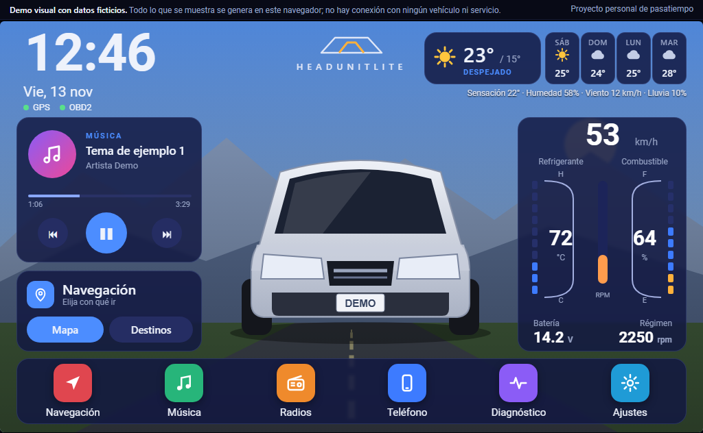
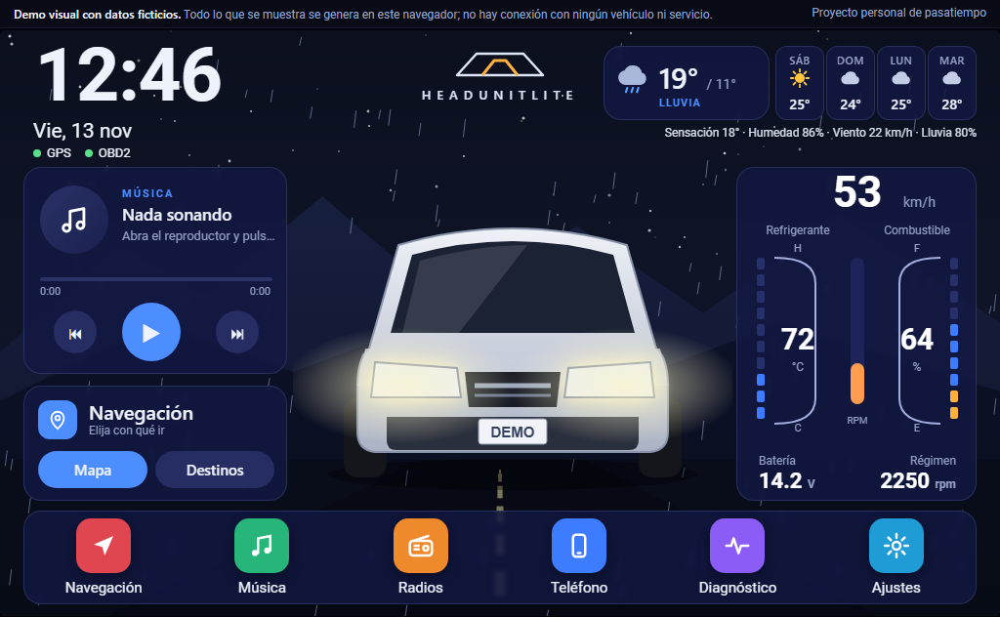
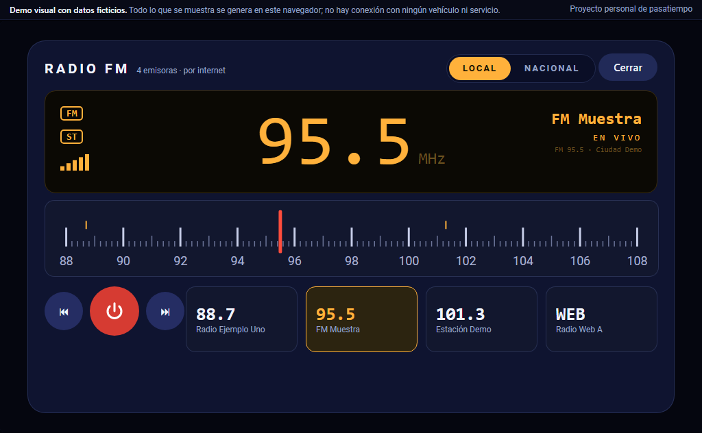
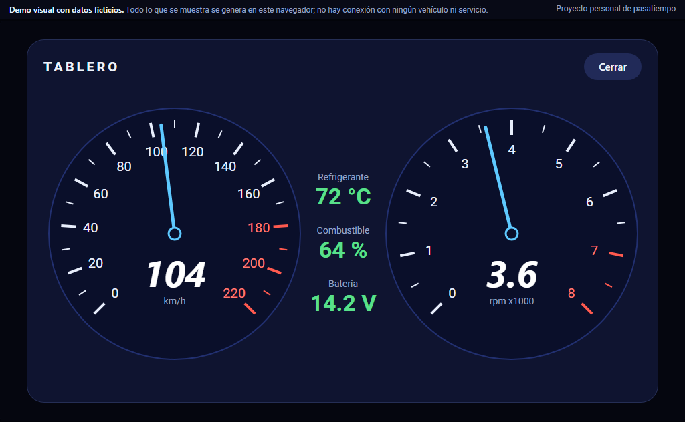

# HeadUnitLite

[English](README.md) · **Español**

Un launcher liviano y una app compañera para radios (head units) Android. Hoy soporta un solo vehículo, un Chevrolet Onix Joy 2018; el soporte para otros autos y radios está en el roadmap, todavía no está implementado.

**Este es un proyecto personal de pasatiempo**, hecho por gusto y para aprender, no un producto comercial. No está afiliado a General Motors ni a Chevrolet.

Desarrollado por Axel Hernán González, con asistencia de IA y un flujo guiado por especificaciones (los requisitos y las decisiones son del autor; el código lo escribió Claude Code).

| Carpeta | Qué es | Stack | Licencia |
|---|---|---|---|
| [`launcher/`](launcher) | Launcher para la pantalla de inicio de la radio del auto: clima, música, radio FM por internet, navegación y diagnóstico OBD2 | Kotlin, Jetpack Compose, MapLibre | AGPL-3.0 |
| [`garage/`](garage) | App compañera para mantenimiento, nafta, neumáticos y viajes diarios, con datos OBD2 en vivo por Bluetooth (ELM327) | Kotlin, Jetpack Compose, Room, Car App Library | MIT |

El archivo `LICENSE` de la raíz (MIT) cubre todo lo que está fuera de `launcher/` y `garage/`, como la demo de `docs/` y los README. Cada carpeta conserva su propia licencia.

## Demo en vivo

**[Abrir la demo interactiva](https://agonzalez-97.github.io/HeadUnitLite/)**: una maqueta visual del launcher con **datos ficticios** generados en el navegador. Es un único archivo `docs/index.html`, sin dependencias ni pedidos de red, con un vehículo dibujado propio y sin marcas de terceros. La demo se publica bajo licencia MIT (`docs/LICENSE`).

| | |
|---|---|
|  |  |
|  |  |

## Roadmap

- Perfiles de vehículo (un archivo de configuración por auto) en lugar de valores atados al Onix.
- Perfiles de radio, detectando qué hardware e integraciones están disponibles.
- Temas, widgets y diseños personalizables.

## Notas sobre esta versión pública

- Este repositorio se creó a partir de una copia limpia de dos proyectos privados, con un único commit inicial. El historial original no se publica.
- El launcher incluye el motor de Android Auto / CarPlay de CarLink (`carlink-core/`, `vendor/`), que es AGPL-3.0. Sus licencias se conservan en cada carpeta.
- Las fotos y logos de terceros del original **no** están incluidos. Las imágenes de `launcher/app/src/main/res/drawable-nodpi/` son placeholders generados.
- No se incluyen claves de firma, claves de API ni credenciales de CarPlay. Para compilar un APK firmado hay que usar una clave propia (ver `launcher/docs/SIGNING.md`).
- Los workflows de CI de `launcher/.github/` vienen del repositorio original y no están activos con esta estructura.
- La mayor parte de la documentación interna está en español.
