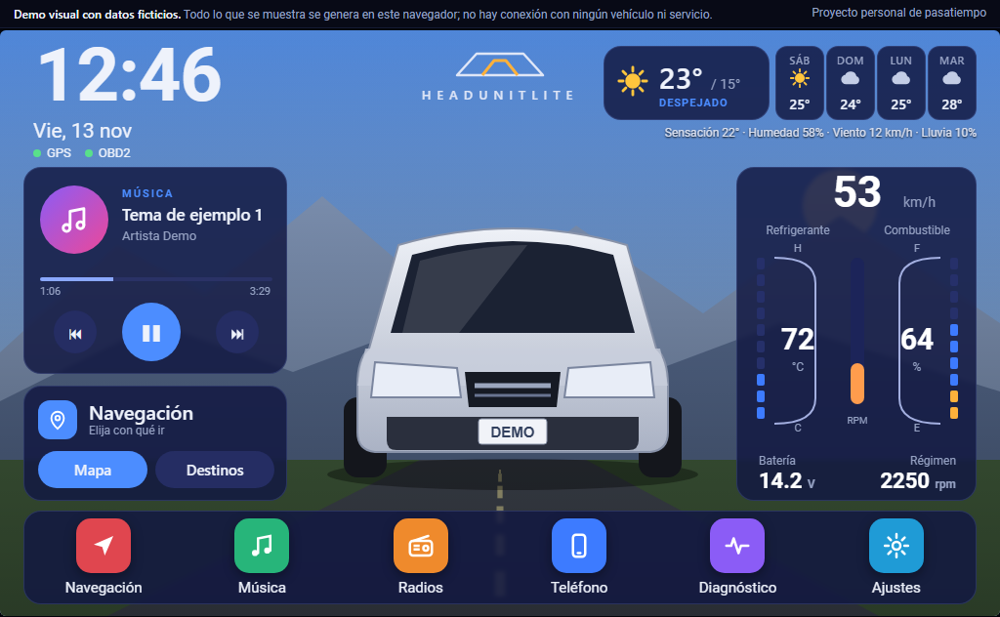
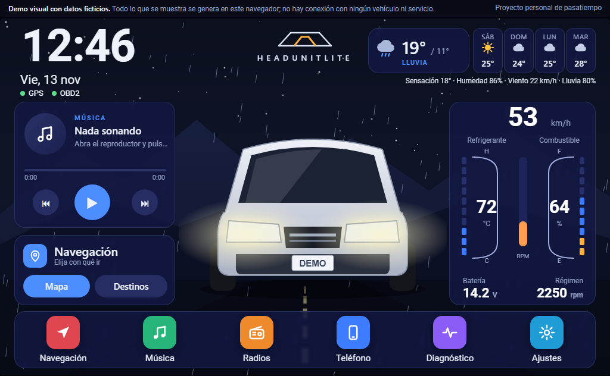
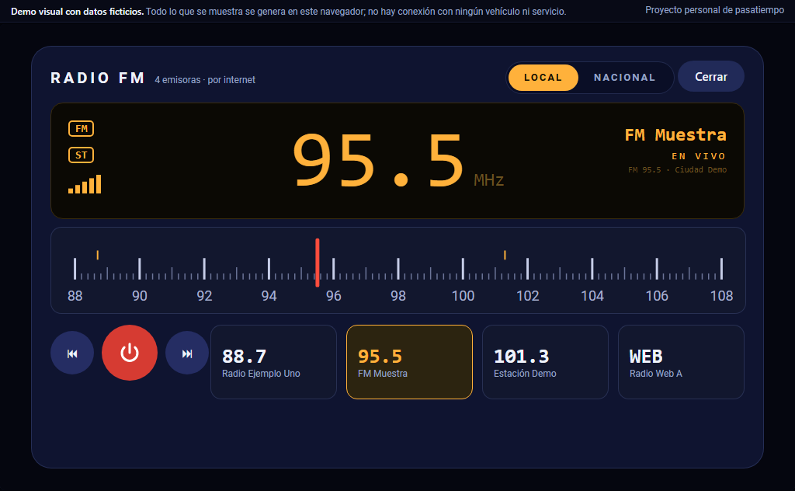
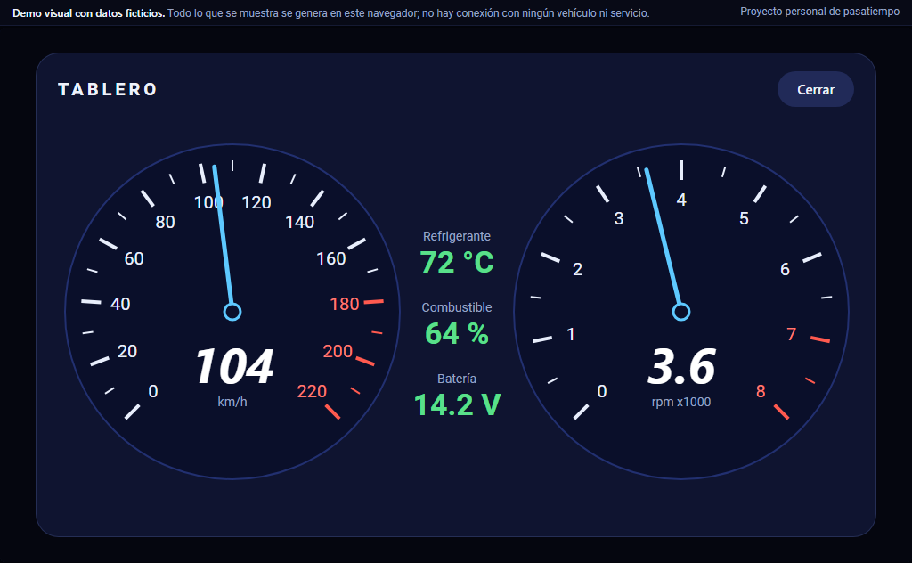

# HeadUnitLite

**English** · [Español](README.es.md)

A lightweight launcher and companion app for Android head units. Today it supports one vehicle, a 2018 Chevrolet Onix Joy; support for other cars and head units is on the roadmap, not implemented yet.

**This is a personal hobby project** built for fun and learning, not a commercial product. It is not affiliated with General Motors or Chevrolet.

Developed by Axel Hernán González, with AI assistance and a spec-driven workflow (requirements and decisions by the author, code written with Claude Code).

| Folder | What it is | Stack | License |
|---|---|---|---|
| [`launcher/`](launcher) | Home-screen launcher for the car's Android head unit: weather, music, FM radio over the internet, navigation, OBD2 diagnostics | Kotlin, Jetpack Compose, MapLibre | AGPL-3.0 |
| [`garage/`](garage) | Companion app for maintenance, fuel, tires and daily trips, with live OBD2 data over Bluetooth (ELM327) | Kotlin, Jetpack Compose, Room, Car App Library | MIT |

## Live demo

**[Open the interactive demo](https://agonzalez-97.github.io/HeadUnitLite/)**: a visual mock-up of the launcher with **fictitious data** generated in the browser. It is a single `docs/index.html` file with no dependencies and no network requests, and it uses its own drawn vehicle and no third-party brands. The demo is released under the MIT license (`docs/LICENSE`).

| | |
|---|---|
|  |  |
|  |  |

## Roadmap

- Vehicle profiles (one config file per car) instead of values tied to the Onix.
- Head unit profiles, detecting which hardware and integrations are available.
- Customizable themes, widgets and layouts.

## Notes about this public version

- This repository was created from a clean copy of two private projects, with a single initial commit. The original history is not published.
- The launcher includes the Android Auto / CarPlay engine from CarLink (`carlink-core/`, `vendor/`), which is AGPL-3.0. Their licenses are kept in each folder.
- Third-party photos and brand logos from the original are **not** included. The images in `launcher/app/src/main/res/drawable-nodpi/` are generated placeholders.
- Signing keys, API keys and CarPlay credentials are not included. To build a signed APK, use your own key (see `launcher/docs/SIGNING.md`).
- The CI workflows under `launcher/.github/` come from the original repository and are not active in this layout.
- Most documentation is written in Spanish.
